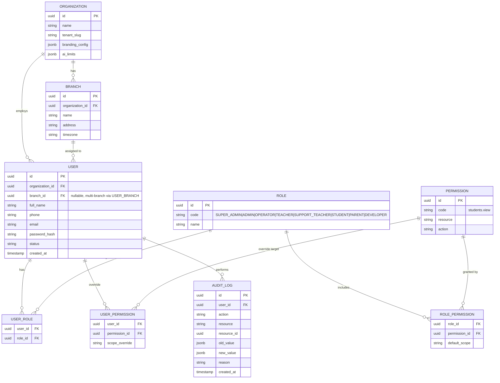
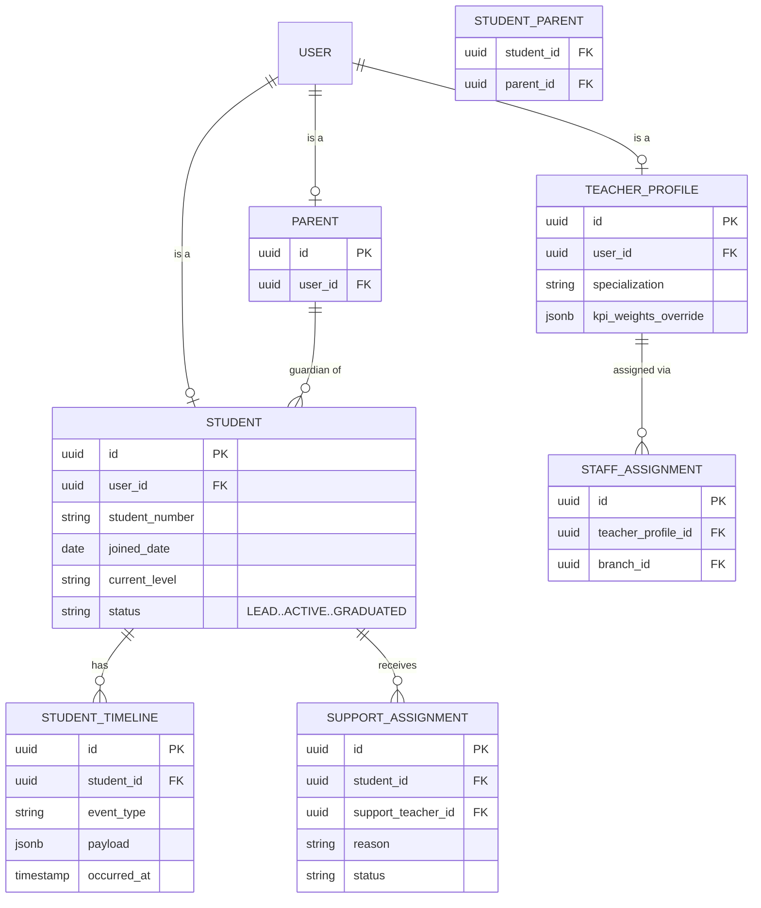
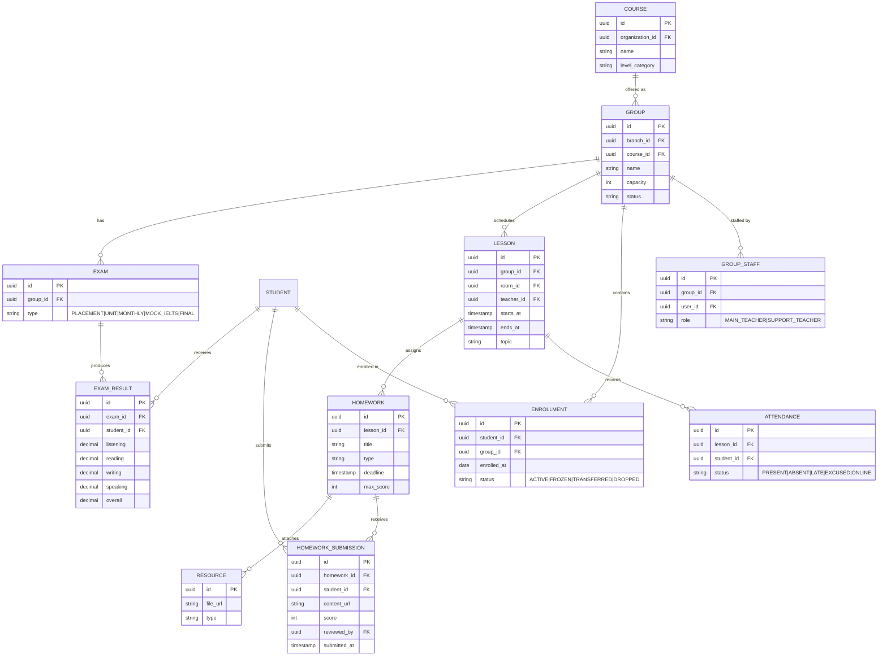
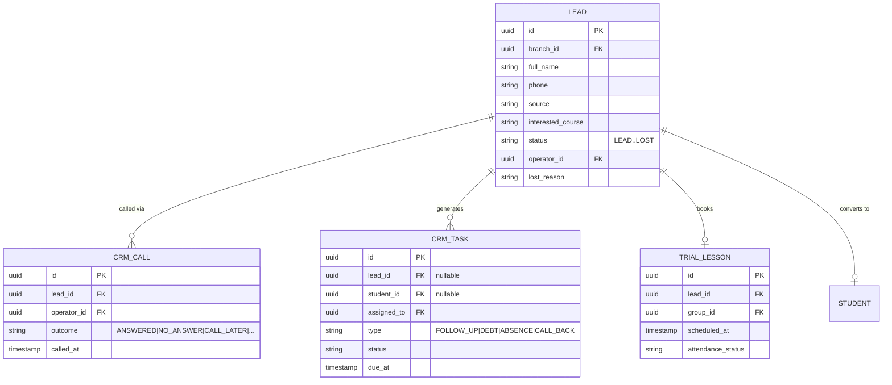
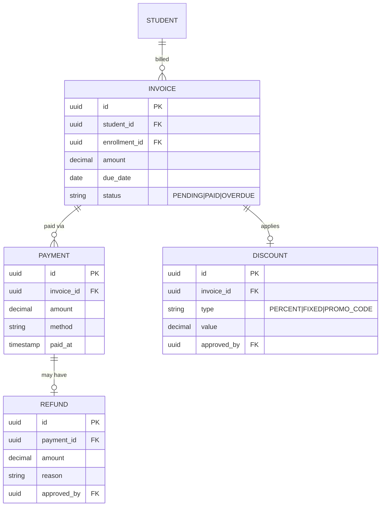
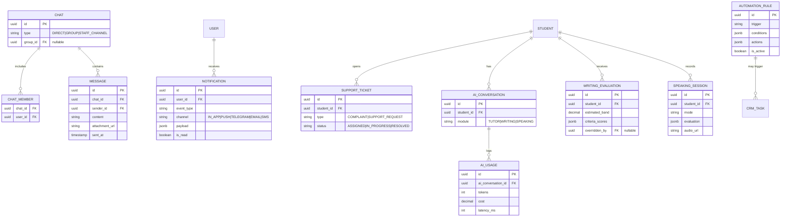

# DATABASE ERD
## Barcha entity va relationshiplar

**Hujjat turi:** Technical Specification (TZ hujjatining davomi)
**Versiya:** 1.0
**Bog'liq hujjatlar:** `00_TZ.md` (§47), `01_role_permission_matrix.md`

Diagramma modul bo'yicha bo'lingan (bitta katta ERD o'qish qiyin bo'lgani uchun). Har bir entity'da `organization_id` va (kerak bo'lsa) `branch_id` bo'ladi — bu ustunlar diagrammaning soddaligi uchun ko'rsatilmagan, lekin barcha jadvallarga tegishli (§48, Multi-tenant).

---

## 1. Identity & Access (Foundation)

---

## 2. People (Students, Parents, Teachers)

---

## 3. Academic (Courses, Groups, Schedule, LMS)

---

## 4. CRM & Lifecycle

---

## 5. Finance

---

## 6. Communication, Notification, Support, AI

---

## 7. Multi-tenant izohi

Har bir jadval (yuqoridagi diagrammalarda ko'rsatilmagan) quyidagi ustunlarga ega bo'ladi:

- `organization_id` — barcha business entitylarda majburiy;
- `branch_id` — filialga tegishli entitylarda (Group, Lesson, Lead, Invoice, va h.k.);
- PostgreSQL darajasida **Row-Level Security (RLS)** yoki EF Core **Global Query Filter** orqali tenant isolation ta'minlanadi.

## 8. Indekslash bo'yicha eslatma (Phase 1 uchun muhim)

- `(organization_id, branch_id)` — deyarli barcha jadvallarda composite index;
- `lead.status`, `enrollment.status`, `invoice.status` — CRM/Finance filtrlash uchun;
- `lesson(teacher_id, starts_at)` va `lesson(room_id, starts_at)` — Conflict Detector uchun kritik;
- `audit_log(resource, resource_id, created_at)`.
